# Kiến trúc và vai trò của LLM

## Dòng dữ liệu

```mermaid
flowchart LR
  S[Người học] --> P[Bộ tạo prompt]
  P --> E[ChatGPT / Claude / Gemini bên ngoài]
  E --> J[JSON do người dùng sao chép]
  J --> Z[Zod: kiểm tra và xem trước]
  Z --> I[Edge import: xác thực và kiểm tra lại]
  I --> D[(Supabase PostgreSQL)]
  D --> Q[Câu hỏi không có đáp án]
  Q --> G[Edge chấm bài]
  G --> T[Giao dịch: lưu lượt làm và snapshot]
  T --> R[Kết quả và sổ tay câu sai]
```

React/Vite là frontend tĩnh; Supabase Auth quản lý mật khẩu và phiên. Không có Node production server, dịch vụ inference hay khóa AI. PDF được đưa trực tiếp cho AI bởi người dùng; trích văn bản tùy chọn chỉ chạy trong browser và chỉ được lưu khi người dùng chủ động sao chép vào tài liệu học rồi nhập JSON.

## Một schema chuẩn

`supabase/functions/_shared/lesson.ts` (frontend re-export: `src/schemas/lesson.ts`) định nghĩa cấu trúc và ràng buộc Zod. Script sinh JSON Schema draft-7 dùng trong prompt và function SQL `private.valid_lesson`. PostgreSQL dùng pg_jsonschema để xác nhận cấu trúc trước khi nhập. Ràng buộc ID duy nhất, thứ tự 5+5 và lựa chọn khác nhau được kiểm tra bổ sung ở cả Zod lẫn SQL vì JSON Schema thông thường không biểu đạt toàn bộ các ràng buộc quan hệ này. Khi thay đổi schema, tạo phiên bản mới và migration mới; không sửa migration đã áp dụng cho hệ thống đang chạy.

Mọi dữ liệu nhập là untrusted. Markdown không hỗ trợ raw HTML, không thực thi JavaScript; react-markdown lọc URL nguy hiểm, KaTeX đặt `trust:false`. JSON giới hạn 1 MB, field/array bị giới hạn. Validation chỉ bảo đảm cấu trúc; nội dung AI cần người học kiểm tra.

## Bảo vệ đáp án và chấm điểm

Bảng `lesson_versions.content` chỉ chứa nội dung học và câu hỏi không có `correctOption`/`explanation`. Hai trường này nằm trong `private.answer_keys`, không được expose qua Data API và không cấp quyền cho `authenticated` hay `anon`. Trang làm bài chỉ gọi API đọc phiên bản public và Edge `grade-quiz`. Function `edit-lesson` riêng biệt cho phép chủ bài chủ động mở toàn bộ JSON để chỉnh sửa; đây là quyền tác giả đã nêu trong yêu cầu, không phải API làm bài.

Edge xác minh người dùng bằng Supabase `getUser(token)`, xác thực payload strict bằng Zod và gọi RPC chỉ dành cho service_role. RPC kiểm tra chủ sở hữu, phiên bản, ID câu hỏi và lựa chọn; trình duyệt không có trường điểm được chấp nhận. Mỗi câu đúng 10 điểm, câu trống sai. PostgreSQL khóa theo chủ/bài, kiểm tra idempotency, tính điểm và ghi toàn bộ snapshot trong một giao dịch. Không có bước ghi lượt làm và ghi đáp án tách rời có thể dở dang.

`quiz_attempts.result.answers` chứa từng câu, lựa chọn, đáp án và giải thích bất biến, thay cho một bảng attempt_answers riêng. Vì JSON snapshot chỉ có tối đa 10 câu và không cần sửa từng đáp án, cách này giữ giao dịch đơn giản và tránh ghép lại lịch sử từ nội dung đang thay đổi. Các lượt nộp hoàn tất chỉ có quyền SELECT cho chủ tài khoản, không UPDATE/DELETE.

## Riêng tư và phiên bản

RLS áp dụng theo `auth.uid()` cho profiles, lessons, lesson_versions, study_progress và quiz_attempts. Bảng private không có policy hoặc grant đọc cho người học. Các thao tác import/edit/grade chỉ chạy dưới service role sau khi Edge xác minh danh tính; các RPC này bị thu hồi EXECUTE từ public/anon/authenticated.

Khóa ngoại kết hợp kiểm tra chủ sở hữu giữa bài học, phiên bản và tiến độ. Mỗi sửa đổi tạo version mới, không sửa version cũ. Lượt làm gắn đúng phiên bản, có snapshot để lịch sử và sổ tay không đổi theo lần sửa sau. Có thể nộp version cũ đã mở trước khi bài được sửa ở tab khác. Xóa bài là soft delete, giữ lịch sử; bài đã xóa không cho bắt đầu/nộp lượt mới. Tài khoản bị xóa sẽ xóa dữ liệu theo cascade.

Môn và chương là metadata tự do, riêng trong bài học, không có danh mục công khai. UI suy ra các nhóm môn/chương từ bài hiện có nên hỗ trợ mọi môn mà không sửa code. Chủ tài khoản tạo hoặc đổi nhóm bằng cách nhập metadata khi tạo/chỉnh sửa bài.

## LLM trong dự án đại học

LLM hỗ trợ xây dựng ứng dụng và tạo tài liệu theo prompt do người học cung cấp. AI StudyLab chịu trách nhiệm xác thực cấu trúc, hiển thị, quản lý, lưu trữ và chấm trắc nghiệm. LLM không đưa ra điểm chính thức, không được truy cập cơ sở dữ liệu và không chạy code trong ứng dụng. Không tuyên bố AI bảo đảm tính đúng đắn học thuật.

## Giới hạn và hướng phát triển

- Đã triển khai Supabase thật và kiểm thử database/RLS/chấm điểm. Email callback và luồng trình duyệt với tài khoản thật được theo dõi trong `VERIFICATION.md`.
- PDF quét, công thức và bố cục phức tạp có thể trích thiếu; không có OCR. Nên đính kèm bản gốc vào AI hỗ trợ PDF.
- Bài học mẫu là tài sản công khai để người dùng nhập; tài liệu riêng không được publish. Không có chia sẻ xã hội.
- Sổ tay cho luyện lại toàn bài gốc, giữ quy tắc 10 câu; chưa có bộ đề riêng chỉ từ câu sai.
- Phiên bản cũ và snapshot làm tăng dung lượng; cần chính sách lưu trữ khi triển khai quy mô lớn.
- Lịch sử hiện tải toàn bộ bản ghi riêng; nên thêm pagination và tổng hợp SQL khi dữ liệu tăng.
- Chưa có tự động kiểm chứng học thuật, OCR, đồng bộ draft nhiều thiết bị hay offline account; đó là hướng mở rộng.
